# pr-state

## Install or update

```sh
python3 -c 'from urllib.request import urlopen; exec(urlopen("https://raw.githubusercontent.com/EndurantDevs/pr-state/main/install.py", timeout=30).read())' && export PATH="$HOME/.local/bin:$PATH"
```

Requires macOS or Linux, Python 3.10+, and [GitHub CLI](https://cli.github.com/).
It reuses your existing `gh` authentication. If you have not signed in, run `gh auth login` once.
No repository configuration is needed.

The same command updates an existing installation. It verifies the downloaded source
against the repository's SHA-256 manifest, then atomically replaces the managed source
and launcher. This checksum detects mismatched downloads; it does not independently
authenticate the publisher. Review [install.py](install.py) before running it if preferred.

Files go in `~/.local/share/pr-state/` with a launcher at `~/.local/bin/pr-state`.
The command adds that directory to the current shell's `PATH`. To keep it available in
new shells, add `export PATH="$HOME/.local/bin:$PATH"` to your shell profile once.
The installer leaves credentials, shell profiles, and unrelated files untouched.

## Use

Replace `OWNER/REPO` and `123` with your repository and PR number:

```sh
pr-state OWNER/REPO 123
pr-state OWNER/REPO 123 --json
pr-state OWNER/REPO 123 --wait --timeout 50 --json
pr-state OWNER/REPO 123 --fresh
```

One line reports the head branch/SHA, recorded base, current target branch/tip, check counts, review
decision, merge state, and observation age. `--json` returns the same information
as one JSON object. `--wait` stays silent until the observation changes or the
timeout expires; JSON includes `changed: true` or `changed: false`.
`--fresh` fetches now and replaces the shared cached observation.
Active `--wait` readers share a 5-second refresh interval. Ordinary reads use a
30-second cache and also benefit from any watcher's newer response. There are no
push notifications: a watcher sees a GitHub change within about 5 seconds plus
request time. Two watchers share each refresh instead of sending two requests.

## Private coordination

Explicitly register a task you own, using a unique worker ID and a contact locator
that other local workers understand:

```sh
pr-state OWNER/REPO 123 --claim worker-a --contact local:worker-a --json
pr-state OWNER/REPO 124 --claim worker-b --contact local:worker-b --after OWNER/REPO#123 --onto main --intent waiting --json
pr-state OWNER/REPO 123 --claim worker-a --contact local:worker-a --intent landing --json
pr-state OWNER/REPO 123 --release worker-a --json
```

Ordinary reads and waits now include `coordination`:

- `claim`: owner/contact, planned head and target, intended rebase destination
  (`onto`), declared predecessors (`after`), intent, and expiry.
- `peers`: unexpired claims on other PRs in the same repository targeting the same
  branch. Each includes its owner/contact and plan, so workers can contact the right owner.
- `landing_conflict`: more than one active record declares `landing`. Owners need
  to agree on an order; the tool does not impose one or block a branch.

For the observed PR, `expired`, `head_matches`, `target_matches`, and
`target_tip_matches` identify an old plan. Peer records are declared snapshots;
their current GitHub heads and dependency merge states have **not** been verified.
`after` and `onto` record intent, not proof that a rebase is valid or authorized.

Claims last 15 minutes by default. Renew by repeating `--claim` with the complete
current plan; omitted predecessors are cleared and omitted intent becomes `working`.
`--lease` accepts 30–3600 seconds; `landing` is capped at 5 minutes. A different owner
cannot replace a live claim. Expired claims can be replaced, and the recorded owner
can release a claim without GitHub access. Reading a PR never claims it automatically.

Records are atomic private files under the same local cache root, separate from
the HTTP response cache. They are shared by this OS user and host/repository,
including across `gh` authentication profiles. They are not posted to GitHub and
do not send messages. Owner IDs are coordination labels, not authenticated identities.
These records help negotiate order without reserving a target branch during development.

## Why share PR observations?



*Illustration of one machine and authentication context. Motion and request timing
are conceptual, not a performance benchmark.*

Parallel workers often watch the same PR. Each can ask GitHub for the same information,
parse the same checks, and report the same unchanged status. `pr-state` gives them
one reusable observation:

- **Fewer duplicate requests.** Readers share GitHub CLI's HTTP cache (30 seconds
  for ordinary reads, 5 seconds while waiting). A
  per-PR file lock lets one reader populate it while the others reuse the response.
- **Less polling chatter.** One normalized line is easier to consume than repeated
  check listings. `--wait` avoids a stream of unchanged output.
- **Clearer state.** Queued, running, failed, skipped, neutral, and unknown checks
  remain distinct. The recorded comparison base and current target tip are separate.

The integration tests start six concurrent ordinary readers for the same one-page PR
and authentication context, and assert exactly one HTTP request. Three concurrent
watchers also share one refresh when the state changes, and an ordinary reader then
reuses their new response. Multi-page check lists
require one request per page. Readers on different machines or using different
credentials do not share responses. This verifies request reuse, not a delivery-time
or CI-runtime speedup.

It is a small Python program using the standard library and the existing
[`gh api --cache`](https://cli.github.com/manual/gh_api) implementation: no daemon,
database, extra service, or Python packages.

For one person watching checks, [`gh pr checks --watch --interval 5`](https://cli.github.com/manual/gh_pr_checks)
is already a good fit. `pr-state` adds shared refreshes across independent local
workers, a bounded wait that returns one observation on change, and normalized
head/base/review information alongside checks. Waiting itself is not new, and any
model-token or delivery-time saving still needs measurement in your workflow.

## Observations and safety

Observations may be up to 30 seconds old. `CHECKS_PASS` describes the check rollup;
it is **not permission to merge**. Required-check policy, approvals, unresolved review
threads, deployment gates, and authorization still need their normal authoritative
checks. Refresh the relevant live state before any PR or CI mutation.
`BEHIND` is information, not an instruction to rebase. A rewritten head needs its own
validation.

All check pages are read, with a shared deadline and consistency checks. Missing,
unknown, incomplete, or changing data is not reported as success. An API, authentication,
pagination, or local-cache error exits nonzero; JSON mode returns `state: "ERROR"`.
A failed CI check itself is an observation and does not make the command fail.

The cache is private to the local OS user, under `$XDG_CACHE_HOME/pr-state` or
`~/.cache/pr-state`. GitHub CLI's response keys include authentication, separating
responses for different credentials. Existing `GH_HOST`, `GH_CONFIG_DIR`, and token
environment variables are honored. Private repository observations stay in the local
cache; avoid copying them into public logs. The tool does not edit GitHub PRs,
dispatch CI, perform rebases, or merge anything.

## Adopt it in a workflow

Installation makes the command available; agents also need persistent instructions.
Add this short rule to your agent's existing instruction file:

```text
For routine per-PR observation, use pr-state OWNER/REPO NUMBER --json.
Wait with --wait --timeout 50. Claim only work you own, using a unique worker ID
and a usable private contact locator. Read coordination.claim and peers before
negotiating rebase/landing order; renew the complete plan and release it when done.
Claims and cached checks never replace live checks, review policy, or authorization.
```

For Codex, use a project `AGENTS.md` or global `~/.codex/AGENTS.md` as described in the
[official instructions guide](https://developers.openai.com/cookbook/examples/gpt-5/codex_prompting_guide).
For Claude Code, an existing project or user-level `CLAUDE.md` works; see its
[instruction-loading documentation](https://code.claude.com/docs/en/memory).
Restart/reload existing sessions or explicitly ask them to read the new rule.
The installer does not silently rewrite agent policies.

Use `pr-state` for routine per-PR observation and `--wait --timeout 50` for bounded
waiting. Preserve efficient batched queries when watching many different PRs.
If the helper fails, make a direct read when needed; an error is never acceptance.

To reduce metadata churn as well, prepare PR titles and descriptions before validation.
Batch optional later edits before the next source push or after the full run ends.
Keep generated summaries in review comments where your review tool supports that.
Make necessary public-content corrections immediately. These habits can avoid
metadata-triggered workflow runs; their effect depends on your workflows.

## Development

With Python and `gh` installed:

```sh
python3 -m unittest -v
```

Tests use synthetic responses and a local HTTP server, including the installed `gh`
client's real cache. They do not need a GitHub token or a live repository. Coverage
includes concurrent readers, credential separation, forced refresh, pagination races,
timeouts, error states, and installer updates that preserve unrelated files.

After changing `pr_state.py`, refresh its checksum before running the tests:

```sh
python3 -c 'import hashlib, pathlib; p = pathlib.Path("pr_state.py"); pathlib.Path("pr_state.py.sha256").write_text(hashlib.sha256(p.read_bytes()).hexdigest() + "  pr_state.py\n")'
```

MIT licensed. See [LICENSE](LICENSE).
